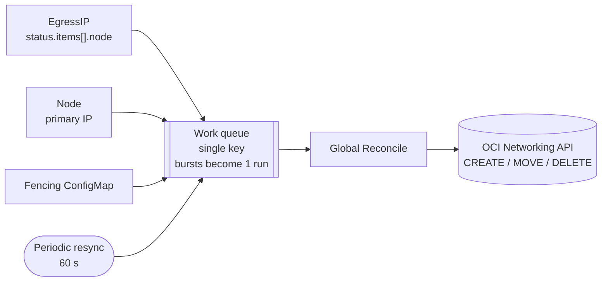

# egressip-oci-controller

A Go controller that keeps OpenShift `EgressIP` objects (OVN-Kubernetes,
`platform: external`) registered as **secondary private IPs on the VNIC of the node**
chosen by OVN, on Oracle Cloud Infrastructure (OCI) and Dedicated Region Cloud@Customer
(DRCC).

OVN-Kubernetes still decides **where** each EgressIP lives. The controller only mirrors
that decision in OCI, whose VCN drops packets whose source IP is not assigned to the
sending VNIC.

## Why

On AWS, Azure, GCP and OpenStack, OpenShift's `cloud-network-config-controller` registers
EgressIPs with the cloud provider. OCI is not a supported platform for that component, so
on clusters installed with `platform: external` / `platformName: oci` the EgressIP is
assigned to a node but never registered on its VNIC, and egress traffic is silently
dropped. Related Red Hat requests: [RFE-6842](https://issues.redhat.com/browse/RFE-6842)
and [RFE-7130](https://issues.redhat.com/browse/RFE-7130). Once native support is
available, this controller should be removed.

## How it works



| Action | When                                                          | OCI API           |
|--------|---------------------------------------------------------------|-------------------|
| CREATE | EgressIP assigned by OVN and missing in OCI                   | `CreatePrivateIp` |
| MOVE   | IP exists on another VNIC (failover, scale-down, reboot)      | `UpdatePrivateIp` |
| DELETE | IP created by this controller whose EgressIP was removed      | `DeletePrivateIp` |
| error  | IP is the primary IP of another VNIC                          | none, Event `OCIAddressConflict` |

The target VNIC is the one holding the node's primary IP (annotation
`k8s.ovn.org/node-primary-ifaddr`, falling back to the `InternalIP` address).

Guarantees:
- **Idempotent**: N runs issue the same calls as one run.
- **Safe garbage collection**: only IPs carrying the freeform tags
  `egressip-oci-managed-by=egressip-oci-controller` and `egressip-oci-cluster=<CLUSTER_ID>`
  are deleted. Primary IPs, untagged IPs, IPs of other clusters and IPs still present in
  any EgressIP `spec` are never deleted.
- **Adoption of pre-existing assignments**: an IP already assigned by hand to the correct
  VNIC results in no call.
- **Isolated failures**: an error on one EgressIP does not block the others; the reconcile
  returns an aggregated error and controller-runtime requeues it with exponential backoff.
- **DR fencing**: the controller acts only when the `egressip-oci-active` ConfigMap has
  `active: "true"`. A missing ConfigMap means inactive.
- **Leader election** (Lease): two replicas, one active, so OCI calls never race.
- **Bounded retries** on transient OCI errors (see [OCI retries](#oci-retries)).

## Design decisions

| Topic | Decision | Reason |
|-------|----------|--------|
| Language | Go, static binary (`CGO_ENABLED=0`) | Final image has no interpreter or runtime packages |
| Image | `ubi9/ubi-micro` | No shell and no package manager; Red Hat supported base |
| Framework | `controller-runtime` v0.23 + `client-go` v0.35 | Same base as kubebuilder; v0.35 matches the Kubernetes version of OpenShift 4.22 |
| EgressIP | `unstructured` | Avoids importing ovn-kubernetes as a dependency |
| CRD / OLM | Not used | No API of its own; deployed with kustomize through RHACM or GitOps |
| OCI auth | `api_key` (default) or `instance_principal` | With instance principal, every pod on the control plane nodes inherits the OCI permissions; an API key limits them to this pod |
| DRCC CA | ConfigMap with `inject-trusted-cabundle` | OpenShift injects the cluster CAs without rebuilding the image |

## OCI retries

The oci-go-sdk applies no retry to the Networking operations used here. The client is
configured with an explicit policy ([internal/ocinet/network.go](internal/ocinet/network.go)):

| Setting | Value |
|---------|-------|
| Retried errors | `409 IncorrectState`, `409 LockConflict`, `429`, `5xx` (except `501`), network errors |
| Not retried | Any other `4xx`, such as `400`, `404 NotAuthorizedOrNotFound`, `409 Conflict` |
| Attempts | 5 |
| Backoff | Exponential, base 2, capped at 8 s, plus up to 1 s of jitter (about 15 s in total) |

`CreatePrivateIp` carries an `opc-retry-token`, so a retried create is not duplicated.
Errors that remain after the last attempt are handled by the controller-runtime requeue.

## CVEs

A Go binary removes the interpreter and system libraries from the image, but **Go standard
library CVEs are compiled into the binary**. Consequences:

1. **Rebuild periodically** with a patched toolchain, not only when the code changes.
2. **Gate builds on `govulncheck`**:
   ```bash
   go install golang.org/x/vuln/cmd/govulncheck@latest
   govulncheck ./...                                     # source (reachable symbols)
   govulncheck -mode binary ./egressip-oci-controller    # final binary
   ```
3. Check the Go version shipped in the UBI `go-toolset`. If it lacks recent fixes, build
   with `--build-arg BUILDER_IMAGE=...` pointing to a current toolchain.

**FIPS**: if the clusters run in FIPS mode, the build path must change (Red Hat go-toolset
with OpenSSL and `CGO_ENABLED=1`, or the native Go FIPS module). This requires changes to
the `Containerfile`.

## Build

```bash
go vet ./...
go test -race ./...
podman build -t REGISTRY/egressip-oci-controller:0.1.0 .
```

`go.sum` is committed; the image build runs `go mod download` and `go mod verify` before
compiling.

## Prerequisites

### Network
- Each EgressIP must be in **the same subnet** as the primary VNIC of the egress nodes.
- A fixed pool of 2–3 nodes labeled `k8s.ovn.org/egress-assignable=""`, outside any
  autoscaled MachineSet, spread across fault domains.
- OCI limit: up to 64 secondary private IPs per VNIC.
- The control plane nodes must reach the OCI Networking endpoint, directly or through a
  proxy (see `HTTPS_PROXY` in [deploy/deployment.yaml](deploy/deployment.yaml)).

### OCI IAM
A dedicated service user in a group whose policy is limited to the node compartment.
Validate the verbs against the OCI policy reference before applying:
```
Allow group egressip-controller to manage private-ips in compartment <compartment>
Allow group egressip-controller to use vnics in compartment <compartment>
Allow group egressip-controller to use subnets in compartment <compartment>
```

## Configuration

| Variable | Flag | Default | Description |
|----------|------|---------|-------------|
| `SUBNET_OCIDS` | `--subnet-ids` | — | Comma-separated OCIDs of the node subnets (**required**) |
| `CLUSTER_ID` | `--cluster-id` | — | Identifier stored in the freeform tags (**required**) |
| `ACTIVE_CONFIGMAP` | `--active-configmap` | `egressip-oci/egressip-oci-active` | Fencing ConfigMap |
| `RESYNC` | `--resync` | `60s` | Full periodic reconciliation |
| `DRY_RUN` | `--dry-run` | `false` | Log actions without changing OCI |
| `OCI_AUTH` | `--oci-auth` | `api_key` | `api_key` or `instance_principal` |
| `OCI_CONFIG_FILE` | `--oci-config-file` | `/etc/oci/config` | OCI configuration file (api_key) |
| `OCI_CONFIG_PROFILE` | `--oci-config-profile` | `DEFAULT` | Profile in the configuration file |
| `OCI_SERVICE_ENDPOINT` | `--oci-service-endpoint` | — | Networking endpoint (DRCC realms) |
| `POD_NAMESPACE` | `--leader-election-namespace` | — | Namespace of the leader election Lease |
| — | `--leader-elect` | `true` | Leader election via Lease |
| — | `--metrics-bind-address` / `--health-probe-bind-address` | `:8080` / `:8081` | Metrics and probes |

## Deployment

1. Edit `deploy/`: image, `SUBNET_OCIDS`, `CLUSTER_ID` and the `oci-credentials` Secret
   (in production, deliver the Secret through External Secrets Operator or Vault).
2. Apply with `DRY_RUN=true` (the default in the manifest):
   ```bash
   oc apply -k deploy/
   oc logs -n egressip-oci -l app=egressip-oci-controller -f
   ```
   Check that the `CREATE` / `MOVE` / `DELETE orphan` lines match expectations.
3. Set `DRY_RUN=false`.
4. Remove any fixed `nodeSelector` pinning EgressIPs to a single node and label the egress
   node pool.
5. For multiple clusters, distribute `deploy/` with an RHACM Policy or an ApplicationSet,
   using one overlay per cluster (`CLUSTER_ID`, `SUBNET_OCIDS`).

## Operations

```bash
# Where OVN placed each EgressIP
oc get egressip -o custom-columns=NAME:.metadata.name,IP:.status.items[*].egressIP,NODE:.status.items[*].node

# Controller actions on an object
oc describe egressip <name>        # Events: OCIPrivateIPCreated / OCIPrivateIPMoved / OCIAddressConflict

# Current leader
oc get lease egressip-oci-controller -n egressip-oci -o jsonpath='{.spec.holderIdentity}'
```

Metrics (port 8080, Service `egressip-oci-controller-metrics`):
- `egressip_oci_actions_total{action="create|move|delete"}`
- `egressip_oci_errors_total`: alert if it keeps growing for several minutes
- standard controller-runtime metrics (`controller_runtime_reconcile_*`)

| Symptom | Likely cause | Action |
|---------|--------------|--------|
| `node X (IP ...) is outside the configured subnets` | `SUBNET_OCIDS` incomplete | Add the node subnet |
| Event `OCIAddressConflict` | EgressIP collides with an instance IP | Change the EgressIP address |
| `NotAuthorizedOrNotFound` | Incomplete IAM policy | Review IAM |
| `x509: certificate signed by unknown authority` | DRCC CA missing from the bundle | Add the CA to `proxy/cluster` (trustedCA) |
| Timeout or `connection refused` at startup | No route to the OCI endpoint | Set `HTTPS_PROXY` / `NO_PROXY` |
| Log `cluster inactive (fencing)` | ConfigMap missing or `active=false` | Check the ConfigMap |

## Tests

Unit tests use a fake Kubernetes client and a fake OCI implementation
([internal/controller/egressip_controller_test.go](internal/controller/egressip_controller_test.go)):

| Test | Verifies |
|------|----------|
| `TestCreateWhenMissing` | CREATE on the correct VNIC, with tags and Event |
| `TestMoveAfterFailover` | MOVE when OVN changes the node (node without OVN annotation uses InternalIP) |
| `TestAdoptsManuallyAssignedIP` | A manually assigned IP on the correct VNIC causes no call |
| `TestIdempotent` | 3 runs = 1 call |
| `TestGarbageCollectOnlyOwnOrphans` | GC skips IPs of other clusters, untagged IPs and IPs pending assignment |
| `TestPrimaryIPConflict` | Conflict with a primary IP: error and Event, no call |
| `TestFencingInactive` | `active=false` or a missing ConfigMap leave OCI unchanged |
| `TestDryRun` | No write calls |
| `TestPartialFailureContinuesAndReturnsError` | A failing EgressIP does not block the others |
| `TestIPOutsideSubnetsIgnored` | IPs outside the subnets are ignored |
| `TestUnknownNodeReturnsError` | An unknown node triggers a retry |

Retry tests run the real SDK client against a local HTTP server
([internal/ocinet/network_test.go](internal/ocinet/network_test.go)):

| Test | Verifies |
|------|----------|
| `TestRetryPolicyBounds` | 5 attempts, 15 s cumulative backoff without jitter |
| `TestRetriesTransientErrors` | `429`, `409 IncorrectState` and `503` are retried |
| `TestDoesNotRetryPermanentErrors` | `409 Conflict`, `404` and `400` are not retried |
| `TestGivesUpAfterMaxAttempts` | Persistent `500` stops after 5 attempts |

Acceptance tests in a real environment should cover provisioning, planned failover
(remove the `egress-assignable` label), node failure (stop the instance and measure the
recovery time), removal (GC) and drift (move the IP by hand).

## Known limitations

- Not yet validated against a real OCI or DRCC environment.
- In DRCC realms the SDK may not recognize the region. Use `OCI_SERVICE_ENDPOINT` or the
  SDK custom region mechanism (`OCI_REGION_METADATA`).
- IPv4 only.
- Nodes with more than one VNIC: the VNIC of the primary IP is always used.
- Out of scope: EgressIP on secondary interfaces (OCI L2 VLAN).
